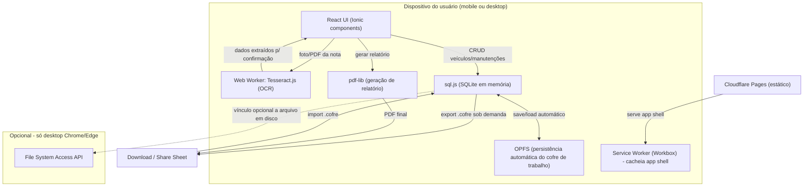

# Discovery Técnico — Sistema de Arquivamento de Manutenções Veiculares

> Complementa o Discovery Conceitual. Foco em stack, arquitetura, tradeoffs e decisões técnicas pendentes.

## 1. Restrições coletadas

| Restrição | Resposta |
|---|---|
| Frontend | **React** |
| Prioridade de plataforma | **Mobile-first** (maioria abre no celular) |
| Time | **Solo dev** |
| Escala esperada (veículos/notas por cofre) | Não respondido — assumido: 1-3 veículos, 20-100 manutenções no caso típico; até ~10 veículos/300+ notas no caso de "power user" (frotinha) |
| Timeline | Não respondido — assumido: MVP para validar rápido, semanas, não meses |
| Testes automatizados | Não respondido — assumido: cobertura mínima, mas obrigatória nos pontos de risco de corrupção de dados (migração de schema, parsing de OCR) |
| Idioma/i18n | Não respondido — assumido: PT-BR apenas no MVP, mas arquitetura não deve travar i18n futuro (strings não hardcoded em componentes) |

As suposições acima devem ser confirmadas antes de travar o roadmap — estão listadas de novo na seção 6.

## 2. Decisão arquitetural central: mobile-first quebra a premissa do "cofre = arquivo"

O discovery conceitual (seção 6.1) modelou o cofre nos moldes do Obsidian: File System Access API como caminho principal, com fallback de upload/download "nos demais navegadores". Isso fazia sentido em um cenário desktop-first.

Com **mobile-first**, essa premissa se inverte na prática:

- **iOS Safari** (incluindo PWA instalada) **não implementa** File System Access API. Não há "abrir/gravar direto no arquivo" ali, ponto final.
- **Android Chrome** tem suporte parcial/mais recente à API, mas é inconsistente entre versões de WebView/Chrome do aparelho do usuário.
- Isso significa que, para a maioria dos usuários mobile, o "fallback" do documento original — upload manual do arquivo para abrir, download manual para salvar — **seria o caminho principal**, não uma exceção.
- Um fluxo onde o usuário precisa manualmente re-exportar e re-importar o arquivo a cada edição é frágil (esquecimento = perda de dados) e não é uma boa experiência mobile.

### Recomendação: separar "armazenamento de trabalho" de "arquivo portátil de backup"

- **Armazenamento de trabalho (dia a dia):** usar **OPFS (Origin Private File System)**, disponível em Chrome/Edge, Firefox 111+ e Safari 15.2+ (desktop e mobile) — funciona igual em qualquer plataforma, sem interação do usuário, com persistência automática. O app salva silenciosamente a cada alteração, como um app nativo salvaria em disco local.
- **Arquivo portátil `.cofre` (o "binário" do documento conceitual):** continua existindo — é o formato de **exportação/importação explícita**, usado para:
  - Backup manual (download / compartilhar via share sheet do celular).
  - Levar o cofre para outro dispositivo (import).
  - Cumprir a proposta de portabilidade e a isenção de responsabilidade (seção 6.7 do conceitual).
- **File System Access API** deixa de ser o mecanismo principal e vira um **enhancement opcional** apenas em desktop Chrome/Edge, para quem quiser vincular o cofre a um arquivo específico no disco (ex.: dentro de uma pasta sincronizada por Google Drive Desktop/Dropbox). Detectado via feature-check; se ausente, cai para o fluxo OPFS + export/import.

Isso muda o "modelo mental" do produto: de "você edita um arquivo" (Obsidian) para "o app guarda seu trabalho sozinho, e você tira cópias quando quiser" (mais parecido com Google Keep/Notion local-first). Vale validar com o usuário se isso ainda comunica bem a mensagem de "seus dados, sua responsabilidade" do H1/H7 — a UI de onboarding e os lembretes de backup (seção 6.7 do conceitual) precisam deixar isso muito claro, já que agora não existe mais um "arquivo aberto" visível o tempo todo.

## 3. Stack recomendada

| Camada | Escolha | Por quê |
|---|---|---|
| Framework | **React 18+ com Vite** | Já é a preferência declarada; Vite dá build rápido e HMR bom para solo dev |
| PWA/Service Worker | **vite-plugin-pwa (Workbox)** | Gera manifest + SW com pouca configuração; cacheia o app shell (conforme já previsto na seção 6.5 do conceitual) |
| UI Kit | **Ionic React** (alternativa: Tailwind + shadcn/ui) | Ionic é feito para apps mobile-web/PWA: componentes touch-friendly, gestos, safe-area, prontos de fábrica — acelera muito um solo dev mobile-first. shadcn/ui é mais leve e mais bonito, mas exige montar mais padrão de interação mobile (sheets, gestos) na mão |
| Estado | **Context API + hooks**, ou **Zustand** se crescer | Não há necessidade de Redux/React Query — não há servidor, os "dados remotos" são o próprio banco local |
| Banco embarcado | **sql.js** para o MVP (mantém a decisão do conceitual) com camada de storage abstraída para permitir troca futura por **wa-sqlite + OPFS VFS** | sql.js carrega o banco inteiro em memória e serializa para bytes — combina bem com o modelo de export/import do `.cofre`. wa-sqlite com VFS de OPFS evita carregar 60-100MB inteiros na memória a cada abertura, mas adiciona complexidade; vale a pena só se o app real mostrar cofres grandes/lentidão |
| Persistência de trabalho | **OPFS** (ver seção 2) | Funciona em todas as plataformas-alvo sem pedir arquivo ao usuário a cada sessão |
| OCR | **Tesseract.js**, rodando em **Web Worker** | Mantém a decisão do conceitual; Web Worker é essencial em mobile para não travar a UI durante o reconhecimento |
| Captura de imagem | `<input type="file" accept="image/*" capture="environment">` | Abre a câmera nativa direto do navegador/PWA em Android e iOS, sem precisar de wrapper nativo (Capacitor) no MVP |
| Geração de PDF | **pdf-lib** | Mantém a decisão do conceitual; client-side, sem servidor |
| Hospedagem | **Cloudflare Pages** | Mantém a decisão do conceitual (permite uso comercial/ads no plano gratuito, ao contrário do Hobby da Vercel) |
| CI/CD | **GitHub Actions** simples (build + deploy automático no Cloudflare Pages a cada push) | Baixo esforço de manutenção para solo dev, evita deploy manual |

## 4. Arquitetura (visão de alto nível)

Nenhum dado do usuário trafega para servidor algum — o único papel do Cloudflare Pages é servir os arquivos estáticos do app (HTML/JS/CSS/WASM), exatamente como no conceitual.

## 5. Tradeoffs das principais decisões técnicas

### 5.1 Persistência: OPFS vs. File System Access API vs. "arquivo sempre visível"

| Alternativa | Prós | Contras |
|---|---|---|
| **OPFS como storage de trabalho + export/import explícito** (recomendado) | Funciona igual em iOS/Android/desktop; zero fricção no dia a dia; sem risco de "esquecer de salvar" | Usuário não vê um "arquivo" o tempo todo — precisa de UX clara de backup para não perder a sensação de controle dos dados |
| File System Access API como caminho principal (proposta original) | Modelo mental idêntico ao Obsidian; arquivo sempre visível no disco | Não existe em iOS Safari; suporte inconsistente em Android; mobile-first torna isso o fallback, não o principal |
| Sempre pedir download/upload manual a cada edição | Mais simples de implementar | Péssima UX mobile; alto risco de perda de dados por esquecimento — não recomendado como único mecanismo |

### 5.2 Motor SQLite: sql.js vs. wa-sqlite+OPFS

| Alternativa | Prós | Contras |
|---|---|---|
| **sql.js** (recomendado para MVP) | Simples, maduro, serializa fácil para o `.cofre` | Carrega o banco inteiro em memória; em cofres grandes (~100MB+) pode pesar em celulares mais fracos |
| wa-sqlite + OPFS VFS | Não precisa carregar tudo em memória; melhor para cofres grandes | Mais complexo de configurar; ecossistema/tooling menos maduro que sql.js; só compensa se surgir problema real de performance |

### 5.3 UI Kit: Ionic React vs. Tailwind/shadcn

| Alternativa | Prós | Contras |
|---|---|---|
| **Ionic React** (recomendado, dado solo dev + mobile-first) | Componentes mobile-nativos prontos (sheets, tabs, gestos, safe-area); acelera muito o MVP sozinho | Visual "Ionic" característico, menos customizável rápido; peso de bundle um pouco maior |
| Tailwind + shadcn/ui | Visual mais moderno/customizável; leve | Exige montar padrões de interação mobile (bottom sheet, swipe) na mão — mais trabalho para solo dev |

### 5.4 Captura/armazenamento de imagem de nota fiscal

Mantida a decisão do conceitual (redimensionar para 1600px, JPEG ~80%, meta ≤500KB) — mas em mobile-first, o processamento (redimensionar + Tesseract) deve rodar **fora da main thread** (Web Worker/OffscreenCanvas) para não travar a UI em aparelhos de entrada.

## 6. Pontos técnicos ainda em aberto (precisam de resposta antes de travar o roadmap)

1. **Escala real esperada** — confirmar se 1-3 veículos/50-100 notas é o caso comum ou se há usuários com frotas maiores. Isso decide se sql.js (mais simples) é suficiente ou se já vale investir em wa-sqlite+OPFS desde o início.
2. **Timeline** — se é MVP de validação rápida (semanas), a recomendação é sql.js + Ionic React sem otimizações prematuras. Se é produto com meses de investimento, vale planejar a migração para wa-sqlite+OPFS desde a modelagem do storage layer.
3. **Nível de testes automatizados** — mínimo recomendado independente da resposta: testes de migração de schema (v1→v2→v3) e testes do parser de OCR→formulário, porque bugs aqui corrompem ou perdem dados do usuário — algo caro de recuperar sem backend.
4. **i18n** — se PT-BR for definitivo, simplifica (sem necessidade de i18n framework); se houver chance de expansão, recomenda-se já isolar strings (ex.: `react-i18next`) desde o início, custo baixo agora, alto depois.
5. **Suporte a navegadores mínimo** — qual a versão mínima de Safari/iOS a suportar (OPFS exige iOS 16.4+ para persistência completa; versões mais antigas de Safari 15.2-16.3 têm suporte parcial/bugs conhecidos de OPFS). Precisa decidir se vale exibir aviso de "atualize seu navegador" para iOS muito antigo.
6. **Tamanho do modelo de OCR em dados móveis** — o modelo `por.traineddata` do Tesseract.js tem alguns MB; em conexão móvel isso pode ser sensível. Decidir se: (a) baixa e cacheia via Service Worker na primeira vez, com aviso de tamanho; ou (b) só oferece OCR quando detectar Wi-Fi (mais complexo, provavelmente fora do MVP).
7. **Ads/monetização e performance mobile** — anúncios (Google AdSense) tendem a pesar em Core Web Vitals mobile. Vale decidir formato/posicionamento de ads que não comprometa a experiência em aparelhos de entrada, já que esse é o público prioritário.
8. **Prioridade do backup em nuvem (Google Drive)** — confirmar se entra logo após o MVP local ou fica para uma fase mais distante do roadmap (ver seção 7).

## 7. Backup automático em nuvem (feature opcional, pós-MVP)

Surgiu a pergunta se seria possível oferecer backup automático do `.cofre` no Google Drive ou iCloud do próprio usuário. É possível, mas os dois provedores têm nível de atrito bem diferente — e a feature reabre a hipótese **H1** do conceitual ("usuários aceitam guardar o arquivo por conta própria, sem backup automático em nuvem").

### 7.1 Google Drive — recomendado como opção pós-MVP

- Escopo **`drive.file`** (não-sensível): dá ao app permissão apenas sobre os arquivos que ele mesmo cria ou que o usuário escolhe compartilhar com ele via Google Picker — não acesso ao Drive inteiro.
- Fluxo 100% client-side via **Google Identity Services (OAuth)** — sem backend próprio, sem servidor/conta de banco de dados adicional.
- O app faz upload do `.cofre` atualizado para o Drive do próprio usuário (ou para `drive.appdata`, pasta oculta específica do app) a cada backup automático.
- **Compatível com a isenção de responsabilidade** (seção 6.7 do conceitual): o app continua não guardando nada em servidor próprio — só delega o armazenamento para a nuvem que o usuário já tem, como um plugin de sync do Obsidian.

### 7.2 iCloud — viável, mas com muito mais atrito

- Não existe uma API equivalente à File System Access API para iCloud Drive a partir da web. O caminho seria **CloudKit JS**.
- Exige **conta paga de desenvolvedor Apple** e a criação de um container `iCloud.*` com schema de registros no CloudKit Dashboard.
- Em uma **PWA instalada no mobile**, o login com Apple ID via CloudKit JS precisa abrir o navegador nativo por razões de segurança — fluxo mais frágil que o do Google dentro de uma webview/PWA.
- Só compensaria revisitar se o app deixar de ser PWA e virar um wrapper nativo (ex.: via Capacitor), onde o CloudKit nativo funciona de forma muito mais integrada.

### 7.3 Decisão

- **Google Drive**: incluir como feature **opcional** nas configurações ("Conectar Google Drive para backup automático"), **não obrigatória** para usar o app — mantém o modelo "sem login" como padrão, oferecendo login apenas a quem optar pelo backup em nuvem.
- **iCloud**: fora de escopo por enquanto, dado o custo (conta de desenvolvedor paga) e a fragilidade do fluxo de autenticação em PWA mobile. Reavaliar se/quando houver uma versão nativa via Capacitor.
- **Timing**: tratar como item **pós-MVP** — o MVP mantém o modelo 100% local (OPFS + export/import manual da seção 2); o backup em nuvem entra como incremento depois de validado o core do produto.

## 8. Resumo da recomendação

Para o cenário **React + mobile-first + solo dev**, a mudança mais importante em relação ao discovery conceitual é: **não depender de File System Access API como caminho principal**. Usar **OPFS** como storage de trabalho automático (funciona em todas as plataformas-alvo) e manter o **`.cofre` exportável/importável** como mecanismo de backup e portabilidade — preservando a proposta de "seus dados, sua responsabilidade" sem forçar o usuário a gerenciar um arquivo manualmente a cada edição, o que seria inviável em mobile.

O restante das decisões do conceitual (sql.js, Tesseract.js, pdf-lib, Cloudflare Pages) permanece válido e compatível com esse ajuste.