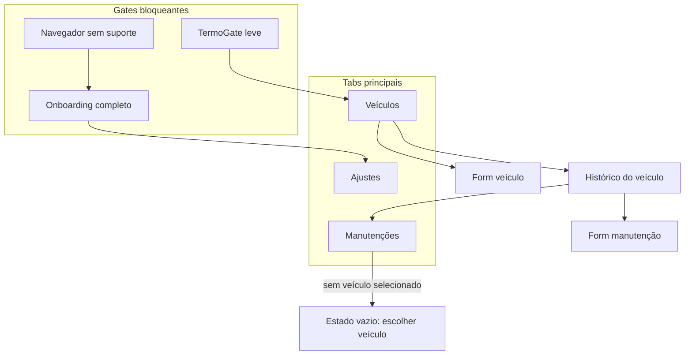
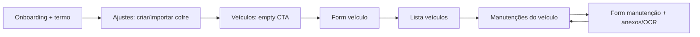
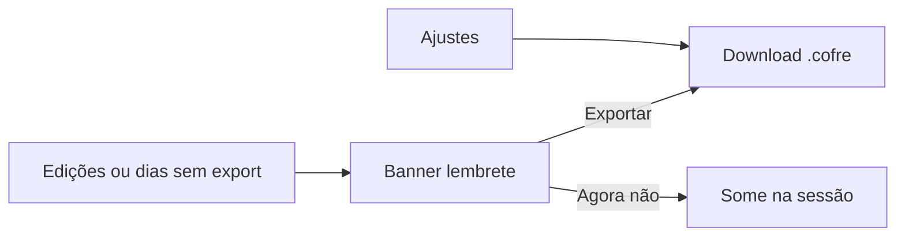
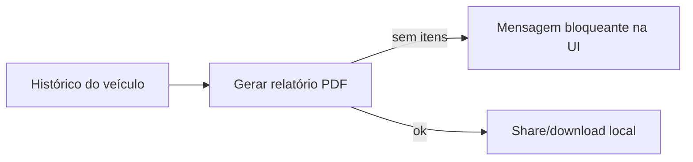

# Inventário de telas e elementos funcionais

> Gerado a partir do código em `src/ui/` (agosto/2026).  
> Objetivo: insumo para redesign de UX/UI — descreve **o que existe hoje**, não como deve ficar.

**Produto:** Histórico de Veículos — PWA mobile-first, sem login, dados só no dispositivo (cofre `.cofre`).  
**UI kit atual:** Ionic React (ADR-003). Redesign pode alterar visual/layout; o comportamento listado aqui é a fonte de verdade funcional.

---

## 1. Restrições que o redesign deve respeitar

| Restrição | Detalhe |
|-----------|---------|
| Mobile-first | Público prioritário no celular; safe-area no tab bar |
| Sem login / sem nuvem de dados | Tudo é local; backup = exportar `.cofre` |
| Monetização | Banner de ads **50px** reservado no rodapé (placeholder); **fora** de cadastro e onboarding |
| Idioma | PT-BR apenas; strings em `src/shared/i18n/pt-BR.ts` |
| Navegação | Sem React Router: estado de tela em `HomePage` (`tab` + `view`) |
| Acessibilidade | Controles nativos/Ionic; confirmações destrutivas via alert; feedback de sucesso/erro em texto |

### Chrome global (sempre presente quando aplicável)

```
┌─────────────────────────────┐
│  [← Voltar?]   Título       │  ← IonHeader / IonToolbar
├─────────────────────────────┤
│                             │
│  Conteúdo da tela           │  ← IonContent (padding)
│  (+ banners / feedback)     │
│                             │
├─────────────────────────────┤
│  [Banner ads 50px]          │  ← oculto em cadastro/onboarding
│  Veículos | Manut. | Ajustes│  ← oculto no onboarding / termo gate
└─────────────────────────────┘
```

- **Voltar** (`header-back`): só em views aninhadas (`veiculo-form`, `manutencoes`, `manutencao-form`).
- **Banner ads:** visível quando há cofre + termo aceito + **não** está em formulário de veículo/manutenção nem onboarding/gate.
- **Tabs:** mesmas condições (exceto formulários ainda mostram tabs; só cadastro esconde ads).

---

## 2. Mapa de navegação (arquitetura de informação)



**Abas:**

| Tab | Ícone atual | Rótulo | Conteúdo padrão |
|-----|-------------|--------|-----------------|
| `veiculos` | `carOutline` | Veículos | Lista de veículos |
| `manutencoes` | `constructOutline` | Manutenções | Histórico do veículo aberto **ou** mensagem pedindo abrir um veículo |
| `config` | `settingsOutline` | Ajustes | Cofre (criar/importar/exportar) + meta + termo |

**Views aninhadas (sem rota URL):**

| View | Origem | Título no header |
|------|--------|------------------|
| `main` | tab ativa | título da tab (ou nome do app em loading/onboarding) |
| `veiculo-form` | lista veículos | Novo veículo / Editar veículo |
| `manutencoes` | botão “Manutenções” no item | Manutenções |
| `manutencao-form` | lista manutenções | Nova manutenção / Editar manutenção |

---

## 3. Telas e estados

### 3.1 Navegador sem suporte (`BrowserUnsupportedGate`)

**Quando:** OPFS indisponível ou abaixo do suporte mínimo (Safari 16.4+).

| Elemento | Tipo | Função |
|----------|------|--------|
| Título do app no header | texto | Identidade |
| Título de erro | H1 | “Navegador sem suporte” |
| Corpo | parágrafo | Orientação para atualizar (Safari 16.4+, Chrome, Edge, Firefox) |

**Sem** tabs, ads, ações. Tela terminal.

---

### 3.2 Loading do cofre

**Quando:** `status === 'loading'`.

| Elemento | Função |
|----------|--------|
| Texto “Abrindo cofre…” | Feedback de espera |

---

### 3.3 Onboarding completo (`OnboardingFlow`)

**Quando:** primeiro uso — termo ainda não aceito **e** nenhum cofre de trabalho.

**Sem** tabs e **sem** ads. Header mostra nome do app.

| # | Elemento | Tipo | Obrigatório / notas |
|---|----------|------|---------------------|
| 1 | Título “Bem-vindo” | H2 | |
| 2 | Intro | parágrafo | Explica proteção dos dados e responsabilidade |
| 3 | Bloco “Salvo automaticamente…” | H3 + texto | Modelo mental do OPFS |
| 4 | Bloco “Faça cópias…” | H3 + texto | Backup em ≥ 2 locais |
| 5 | Bloco “Como exportar…” | H3 + texto | Aponta para Ajustes → Exportar |
| 6 | Termo de isenção | H3 + 3 parágrafos | Texto canônico legal |
| 7 | Checkbox | aceite | “Li e aceito o termo…” — habilita CTA |
| 8 | Hint se não marcado | texto médio | “Aceite o termo para criar ou importar…” |
| 9 | CTA “Aceitar e continuar” | botão block | Desabilitado sem checkbox |
| 10 | Hint de recusa | texto médio | Sem aceite não cria/usa cofre |

**Pós-aceite:** navega para aba **Ajustes** (para criar/importar cofre).

---

### 3.4 TermoGate (aceite leve)

**Quando:** já existe cofre no dispositivo, mas prefs locais ainda sem aceite (ex.: upgrade).

| Elemento | Função |
|----------|--------|
| Título “Aceite necessário” | |
| Corpo curto | Por que precisa aceitar |
| Termo completo | Mesmos parágrafos |
| Checkbox + CTA “Aceitar e continuar” | Igual onboarding, sem os blocos educativos longos |
| Hint de recusa | |

**Sem** tabs/ads até aceitar.

---

### 3.5 Aba Veículos — lista (`VeiculosList`)

**Header:** “Veículos”. **Ads + tabs:** sim.

#### Empty state

| Elemento | Função |
|----------|--------|
| Título “Nenhum veículo cadastrado” | |
| Corpo explicativo | Convite a cadastrar o primeiro |
| CTA “Cadastrar primeiro veículo” | Abre form de criação |

#### Com veículos

| Elemento | Função |
|----------|--------|
| H2 “Veículos” | |
| Botão “Novo veículo” | Só aparece se `length > 0` |
| Lista (`IonList`) | Um item por veículo |

**Por item de veículo:**

| Elemento | Conteúdo / ação |
|----------|-----------------|
| Título | Placa |
| Subtítulo | Marca / modelo |
| Meta | `km` + opcional `ano` + opcional `próxima troca` |
| Botão “Manutenções” | Abre histórico e troca tab para Manutenções |
| Botão “Editar veículo” | Abre form de edição |
| Botão “Excluir” | Abre alerta de confirmação |

**Alerts de exclusão:**

1. **Sem histórico:** “Excluir veículo?” → Cancelar / Excluir  
2. **Com manutenções:** “Excluir veículo e histórico?” — aviso de perda de manutenções + anexos → Cancelar / “Excluir veículo e histórico”

---

### 3.6 Formulário de veículo (`VeiculoForm`)

**Header:** Novo / Editar. **Ads:** ocultos. **Voltar** no header.

| Campo | Label | Tipo | Obrigatório |
|-------|-------|------|-------------|
| `placa` | Placa | texto | Sim |
| `marcaModelo` | Marca / modelo | texto | Sim |
| `anoModelo` | Ano / modelo | número | Não |
| `kmAtual` | Km atual | número | Sim (≥ 0); default criação `0` |
| `proximaTroca` | Próxima troca prevista | texto livre | Não |

| Ação | Função |
|------|--------|
| Salvar | Valida; sucesso → volta à lista |
| Cancelar / Voltar | Descarta e volta à lista |
| Erros de campo | Por campo + resumo textual |

---

### 3.7 Aba Manutenções — escolher veículo

**Quando:** tab Manutenções sem veículo selecionado (`view.kind === 'main'`).

| Elemento | Função |
|----------|--------|
| Texto | “Abra um veículo em Veículos e toque em Manutenções…” |

---

### 3.8 Histórico de manutenções (`ManutencoesList`)

**Header:** “Manutenções”. **Voltar** → lista de veículos. **Ads + tabs:** sim.

| Elemento | Função |
|----------|--------|
| Botão “Nova manutenção” | Só se já há itens |
| Título | “Manutenções — {placa}” |
| Hint de ordenação | “Mais recentes primeiro” |
| Botão “Gerar relatório PDF” | Outline, block; desabilitado se lista vazia ou gerando |
| Hint se vazio p/ relatório | Explica que precisa ≥ 1 manutenção |
| Feedback relatório | Sucesso (live) / erro (assertive) |

#### Empty state

| Elemento | Função |
|----------|--------|
| Título / corpo | Sem manutenções |
| CTA “Registrar primeira manutenção” | Abre form |

#### Com itens — por manutenção

| Elemento | Conteúdo |
|----------|----------|
| Título | Data (`YYYY-MM-DD`) |
| Subtítulo | Tipo de serviço |
| Meta | km · valor (BRL, se houver) · oficina (se houver) |
| Editar | Abre form |
| Excluir | Alert: Cancelar / Excluir |

---

### 3.9 Formulário de manutenção (`ManutencaoForm`)

**Header:** Nova / Editar. **Ads:** ocultos. **Voltar** limpa anexos pendentes e volta ao histórico.

Ordem visual atual (topo → base):

#### A) Seção Anexos (`AnexosSection`) — no topo

| Elemento | Função |
|----------|--------|
| Título “Anexos da nota” | |
| Hint OCR | Foto tenta pré-preencher; PDF sem OCR automático |
| Erro / “Processando imagem…” | Estados de processamento |
| “Anexar foto (câmera ou galeria)” | `input` `image/*` + `capture="environment"` |
| “Anexar PDF” | `input` PDF |
| Empty | “Nenhuma nota anexada…” |
| Lista de anexos | Nome + tamanho; Visualizar / Remover |
| Preview | Imagem inline ou iframe PDF + Fechar |
| Alert remover anexo | Confirmação destrutiva |
| Alert PDF ≥ ~2 MB | “Anexar mesmo assim” / Cancelar |

**Comportamento de criação vs edição:**  
- **Nova manutenção:** anexos ficam pendentes em memória até Salvar.  
- **Edição:** anexo persiste na hora.

#### B) Feedback OCR (após anexar imagem)

| Estado | UI |
|--------|-----|
| Processando | “Lendo a nota…” + “Cancelar OCR” |
| Sucesso | “Sugestões aplicadas. Revise…” |
| Sem campos | Nota anexada; preencher manual |
| PDF | Aviso: sem OCR; preencher manual |
| 1ª vez (modelo) | Alert ~MB: Baixar / Continuar sem OCR |
| Erro | Alert: Tentar de novo / Continuar sem OCR |

OCR **só preenche campos vazios**; edição humana prevalece. Nunca bloqueia salvar.

#### C) Campos do formulário

| Campo | Label | Tipo | Obrigatório |
|-------|-------|------|-------------|
| `data` | Data | date | Sim |
| `km` | Km | número | Sim (≥ 0) |
| `tipoServico` | Tipo de serviço | texto | Sim |
| Peças (lista) | Descrição + Valor por item | repetidor | Não (lista vazia ok) |
| | “Adicionar peça” / “Remover” | | |
| `valorTotal` | Valor total | readonly, BRL | Soma automática das peças |
| Hint | “Soma automática das peças” | | |
| `oficina` | Oficina | texto | Não |
| `proximaRevisao` | Próxima revisão prevista | texto | Não |

| Ação | Função |
|------|--------|
| Salvar | Valida; em criação faz flush dos anexos pendentes |
| Cancelar / Voltar | Descarta pendentes e volta ao histórico |

---

### 3.10 Aba Ajustes (config / cofre)

**Header:** “Configurações e backup”. **Ads + tabs:** sim (se termo aceito).

| Elemento | Função |
|----------|--------|
| H2 + subtítulo | Backup frequente; app não envia dados |
| Texto do cofre | “Dados ficam só neste dispositivo…” |
| Empty | “Nenhum cofre… Crie ou importe” |
| Meta (se sessão) | Versão do conteúdo + última modificação |
| “Criar cofre novo” | Primary; exige termo aceito |
| “Importar arquivo .cofre” | Outline; file picker `.cofre` |
| “Exportar .cofre” | Outline; desabilitado sem sessão; marca backup confirmado |
| “Ver termo de isenção” | Clear, small → modal |

**Alert import com cofre existente:** “Substituir cofre atual?” — Cancelar / Substituir (irreversível).

---

## 4. Overlays, banners e feedback global

### 4.1 Backup reminder (`BackupReminderBanner`)

**Quando:** termo ok + sessão + **não** em cadastro + (5 edições **ou** 7 dias sem export).  
Não bloqueante. Dispensar = só nesta sessão.

| Elemento | Função |
|----------|--------|
| Título / corpo | Incentiva export |
| “Exportar .cofre” | Dispara export |
| “Agora não” | Dismiss da sessão |

### 4.2 Modal do termo (`TermoModal`)

Consulta somente leitura do termo (aberto em Ajustes). Header + Fechar.

### 4.3 Feedback global no conteúdo

Mensagens de sucesso/erro de cofre, veículos, manutenções, anexos e relatório sobem para o topo do `IonContent` (texto verde/vermelho), fora dos formulários em fluxo.

### 4.4 Inventário de alerts (confirmações)

| Contexto | Título (resumo) | Ações |
|----------|-----------------|-------|
| Substituir cofre | Substituir cofre atual? | Cancelar / Substituir |
| Excluir veículo | Excluir veículo? | Cancelar / Excluir |
| Excluir veículo + histórico | Excluir veículo e histórico? | Cancelar / Excluir… |
| Excluir manutenção | Excluir manutenção? | Cancelar / Excluir |
| Remover anexo | Remover anexo? | Cancelar / Remover |
| PDF grande | PDF grande | Cancelar / Anexar mesmo assim |
| OCR modelo | Baixar modelo de OCR? | Continuar sem OCR / Baixar |
| OCR falha | Extrair dados da nota | Continuar sem OCR / Tentar de novo |

---

## 5. Fluxos principais (para wireframes)

### 5.1 Primeiro uso → primeiro veículo → primeira manutenção



### 5.2 Backup recorrente



### 5.3 Relatório PDF



---

## 6. Checklist de elementos por tela (rápido)

| Tela | CTAs principais | Listas | Forms | Confirmações | Empty states |
|------|-----------------|--------|-------|--------------|--------------|
| Unsupported | — | — | — | — | tela inteira |
| Onboarding | Aceitar | — | checkbox | — | — |
| TermoGate | Aceitar | — | checkbox | — | — |
| Veículos | Novo / 1º cadastro | veículos | — | 2 deletes | sim |
| Form veículo | Salvar / Cancelar | — | 5 campos | — | — |
| Pick veículo | — | — | — | — | mensagem |
| Histórico | Nova / 1ª / PDF | manutenções | — | delete | sim |
| Form manutenção | Salvar / Cancelar / anexar | anexos + peças | campos + OCR | anexo/PDF/OCR | anexos |
| Ajustes | Criar / Import / Export / Termo | meta | — | replace | cofre vazio |
| Banner backup | Export / Agora não | — | — | — | — |

---

## 7. Notas para o redesign (oportunidades observadas no código atual)

Estas não são requisitos — são pontos onde a UI hoje é “funcional mínima” e um redesign costuma atacar:

1. **Hierarquia de ações nos itens de lista** — três botões empilhados (Manutenções / Editar / Excluir) competem visualmente; swipe actions, menu “⋯” ou card com CTA primário único podem reduzir carga.
2. **Tab Manutenções sem contexto** — estado vazio genérico; redesign pode aprofundar deep-link / último veículo / atalho na home.
3. **Form de manutenção longo** — anexos + OCR + peças + campos em uma única rolagem; seções colapsáveis ou wizard “nota → dados → revisar” são candidatas.
4. **Valor total** — campo readonly no meio do form; pode virar resumo sticky ou linha de totais.
5. **Ajustes = cofre** — mistura backup, versão e termo; redesenhar como “Backup e dados” com status visual do último export.
6. **Onboarding denso** — termo + educação em uma tela; possível stepper (3 passos) mantendo o aceite obrigatório no fim.
7. **Banner ads** — altura fixa 50px; redesign deve reservar espaço e não empurrar CTAs críticos para baixo do fold sem scroll consciente.
8. **Feedback** — mensagens de sucesso no topo somem do contexto da ação; toasts/snackbars acessíveis (`aria-live`) melhoram percepção sem mudar regras.

---

## 8. Arquivos de referência (implementação atual)

| Área | Arquivos |
|------|----------|
| Orquestração / navegação | `src/ui/pages/HomePage.tsx` |
| Shell | `src/ui/shell/*` |
| Veículos | `src/ui/veiculos/VeiculosList.tsx`, `VeiculoForm.tsx` |
| Manutenções | `src/ui/manutencoes/ManutencoesList.tsx`, `ManutencaoForm.tsx` |
| Anexos / OCR UI | `src/ui/anexos/AnexosSection.tsx` (+ OCR no form) |
| Onboarding | `src/ui/onboarding/*` |
| Copy | `src/shared/i18n/pt-BR.ts` |
| Termo legal | `src/shared/legal/termoIsencao.ts` |

Specs de comportamento (não de layout): `docs/specs/*.md`.
